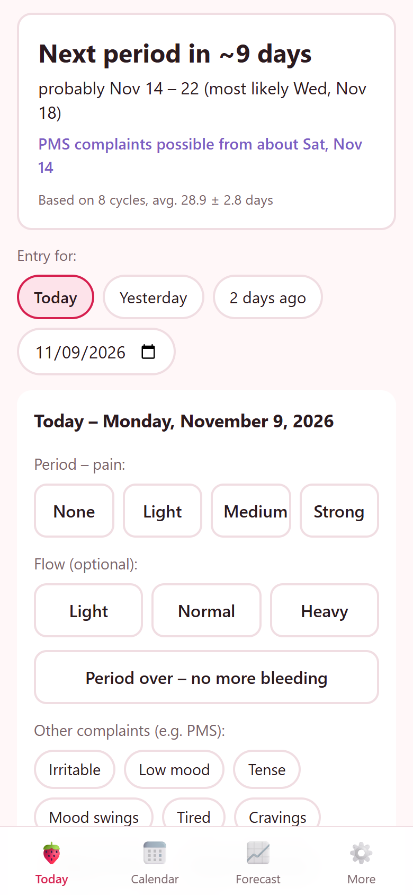
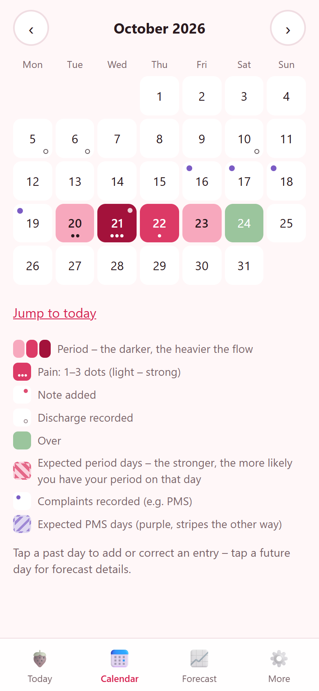
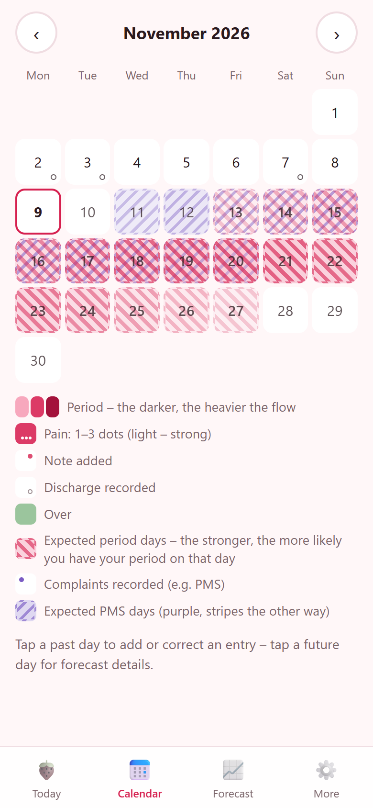
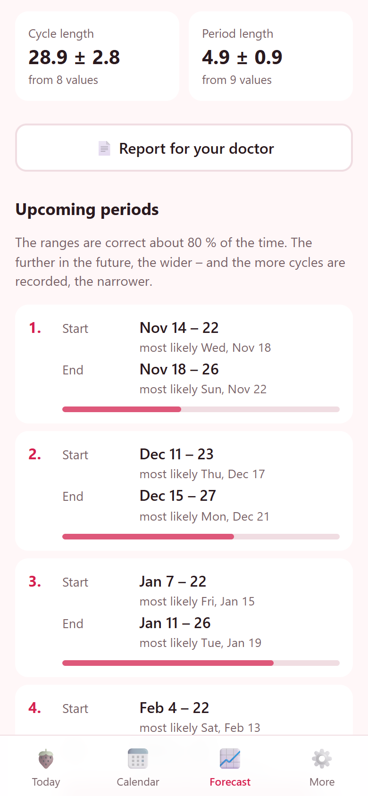
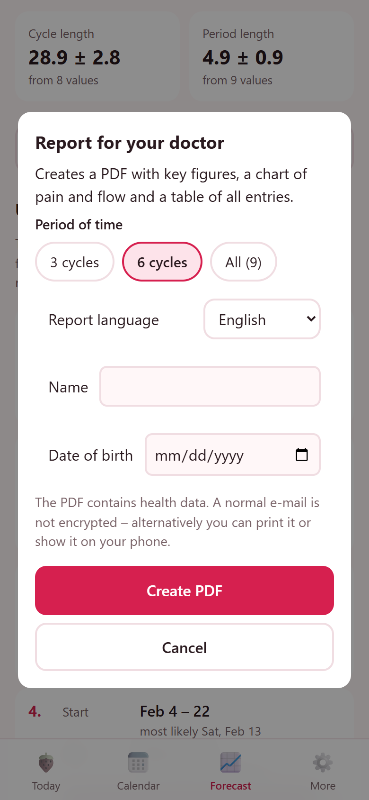
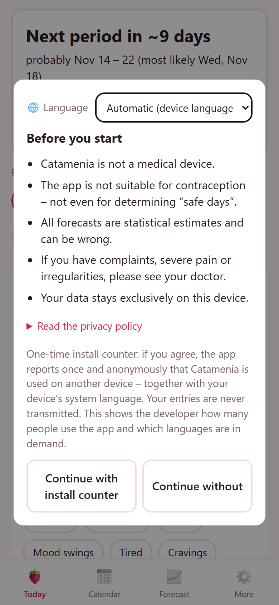
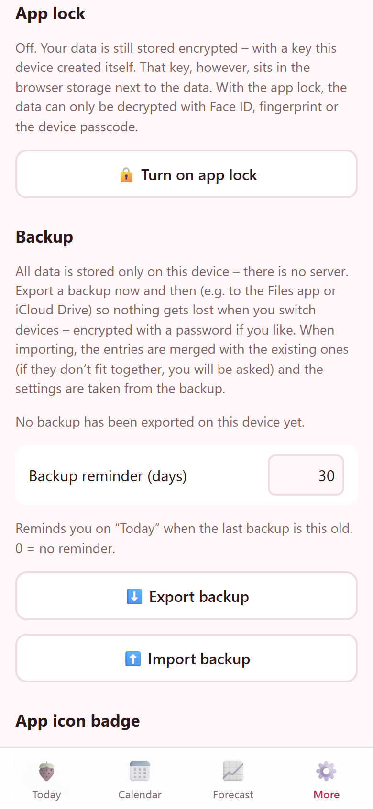
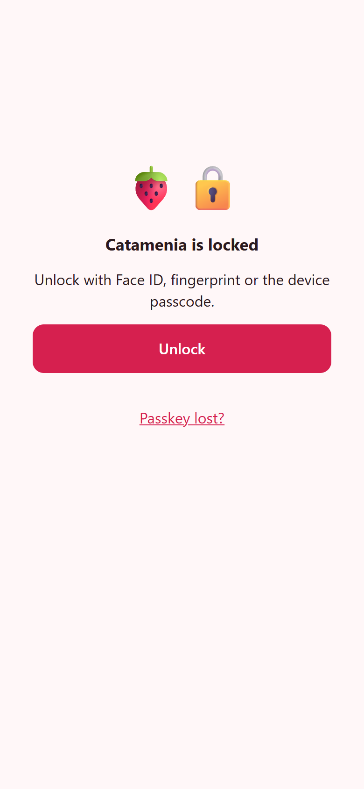
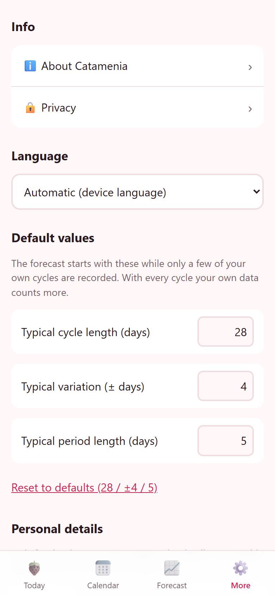

# 🍓 Catamenia – private period tracker (web app)

**Open the app: https://oxi75.github.io/catamenia/** · version 0.9.0 · free, no account, no ads

> 🇩🇪 **Kurz auf Deutsch:** Catamenia ist eine kostenlose Web-App (PWA) zum Erfassen der Periode
> (Schmerzen, Blutungsstärke, Notizen), weiterer Beschwerden wie PMS-Symptome und Ausfluss, mit
> statistischer Vorhersage der nächsten Perioden und PMS-Tage inkl. Unsicherheitsbereich,
> Überfällig-Warnung, PDF-Bericht für die Frauenärztin / den Frauenarzt und optional
> passwortverschlüsselter Datensicherung mit Erinnerung.
> Alle Daten bleiben ausschließlich auf dem Gerät, dort immer verschlüsselt, optional mit
> App-Sperre per Face ID / Gerätecode – kein Server, kein Konto, keine Werbung.
> Sprachen: Deutsch, Englisch, Polnisch, Türkisch, Ukrainisch. Installation: Seite im Browser öffnen →
> „Zum Home-Bildschirm“ / „App installieren“.

Catamenia (medical term for menstruation, Greek *katamēnia*, "the monthly") records periods and
forecasts the next ones with an honest uncertainty range. It runs in the browser and can be
installed on the home screen of iPhone and Android like a native app – without an app store.

**All data stays on the device.** There is no server, no user account, no cookies and no tracking.
The only optional exception is a one-time, anonymous install counter that the user explicitly
chooses (see [Privacy](#privacy)).

This repository contains only the compiled app that is served via GitHub Pages; the source code
is not public. This README describes what the app does and how it works.

---

## Screenshots

<table>
<tr>
<td align="center"> Today: status and quick entry</td>
<td align="center"> Calendar: colour = flow, dots = pain</td>
<td align="center"> Calendar: forecast probability</td>
</tr>
<tr>
<td align="center"> Forecast with 80 % ranges</td>
<td align="center"> PDF report for the doctor</td>
<td align="center"> Start-up notice and consent</td>
</tr>
<tr>
<td align="center"> Always encrypted, optional app lock</td>
<td align="center"> Lock screen: Face ID / passcode</td>
<td align="center"> More: language and settings</td>
</tr>
</table>

Screenshots show fictitious demo data. Sample PDF reports:
[English](sample-report-en.pdf) · [Deutsch](sample-report-de.pdf)

---

## Features

### Recording
- One tap for today, yesterday or the day before; any earlier date via date picker
  (retroactive entries and corrections are always possible).
- Per day: **period** with **pain level** (none / light / medium / strong), optional **flow**
  (light / normal / heavy), **"period over"**, free-text **note**.
- **Further complaints (e.g. PMS)** on any day, also without a period: irritable, low mood, tense,
  mood swings, tired, cravings, sleep problems, breast tenderness, bloating, headache (after the
  symptom groups of the DRSP, the standard diary for PMS/PMDD) plus an overall severity.
- **Discharge** (clear / milky) on any day. Recorded separately on purpose: it changes over the
  cycle by itself (clear around ovulation), so it is not counted as a complaint and does not
  distort the PMS evaluation.
- Periods, cycle lengths and forecasts are never stored – they are recomputed from the day
  entries, so every correction is immediately consistent everywhere.

### Today screen
- Status: welcome · "day *n* of your period" with expected end · "next period in ~*n* days" with
  range and most likely day · "period is due" · **"overdue by *n* days"**.
- How reliable the forecast is: "based on *n* cycles, avg. 28.6 ± 2.3 days".
- With a recurring premenstrual pattern: "PMS complaints possible from about …".
- **Backup reminder** when the last backup is older than the chosen interval (default 30 days,
  adjustable under *More*, 0 = off), with "Back up now" and "Later".
- Optional badge on the app icon with the number of overdue days (where the OS supports it).

### Calendar
- Month view; recorded period days: **colour = flow** (light pink … dark red), **1–3 dots = pain**,
  corner mark = note, purple dot = complaints, small ring = discharge; "over" days marked.
- Future days shaded by the **probability** that they are period days, and with purple stripes in
  the other direction by the probability of **PMS complaints**.
- Tap a past day to edit it, a future day for forecast details (probability, which predicted
  period it belongs to, its start/end range).

### Forecast
- Cycle length and period duration as mean ± spread and how many own values they are based on.
- The **next 6 periods**, each with an **80 % range** for start and end, the most likely day and a
  bar showing the width of the uncertainty.
- **PMS evaluation:** in how many cycles complaints occurred in the 5 days before the period,
  typical onset, most frequent symptoms, complaints in mid-cycle, next expected PMS days – or
  what is still missing (2 cycles with complaints). Clearly marked as not a diagnosis.
- History table: start, duration, cycle length, maximum pain of every period.

### PDF report for the doctor
- Created entirely on the device; choose 3 / 6 / 12 / all cycles and the **report language
  independently of the app language** (e.g. app in Turkish, report in German).
- Page 1: name and date of birth (optional), period of time, key figures (average / shortest /
  longest cycle and period, last period, estimated next start, PMS evaluation) and a **chart of
  pain and flow** for every cycle.
- Following pages: table of all entries grouped by cycle (date, cycle day, pain, flow,
  complaints incl. discharge, note).
- Footer with app version, "self-recorded data, not a diagnosis" and page numbers.
- **Share** (share sheet → Mail with attachment, Messenger, "Save to Files") or **save**
  (download). See the [samples](#screenshots).

### Backup and import
- Export all data as a JSON file (share sheet or download) – optionally **encrypted with a
  password** (at least 10 characters; AES-256-GCM, key derived with PBKDF2-SHA-256, 600 000
  rounds). The password is never stored; the import only asks for it when the file is encrypted.
- Shows the date of the last backup; optional reminder on the today screen (interval adjustable,
  default 30 days, 0 = off).
- **Smart import:** the backup is compared with the data on the device:
  - identical → nothing changes;
  - compatible (e.g. older backup, or newer data from another device) → merged automatically;
  - suspicious → warning with the reasons and a choice: *cancel* / *replace device data* /
    *merge anyway*. Detected problems: contradicting entries on the same day, merging would create
    an implausibly short cycle (< 18 days – typical for data of two different persons), two
    shifted periods would grow into one long period, very different typical cycle lengths.

### More
- Languages: **German, English, Polish, Turkish, Ukrainian** – device language by default, switchable any time
  (also directly in the start-up notice).
- Adjustable prior values (typical cycle length, variation, period duration) used while there is
  little personal data.
- Optional personal details (name, date of birth) – only printed on the PDF report.
- Optional **app lock** with Face ID / fingerprint / device passcode (passkey); the content is
  covered in the background and locked again after 1, 5 or 15 minutes.
- Delete all data; about page with version, update check, licences of the open-source components.
- **Works offline** after the first visit; updates are downloaded in the background and activated
  with one tap ("Version x.y.z is ready." → "Update now").

---

## How the forecast works

1. **Days → periods:** consecutive period days form a period (one forgotten day in between is
   tolerated); "over" ends it. Cycle length = start to next start (values outside 10–120 days are
   ignored as errors or pauses).
2. **Robust weighted statistics:** recent cycles weigh more (each older one × 0.9). Outliers –
   e.g. a "56-day cycle" because a period was not entered – are detected with median and MAD and
   strongly damped.
3. **Prior values:** while there is little data, the forecast is blended with the prior
   (default 28 ± 4 days, worth 1.5 cycles); every own cycle reduces its influence.
4. **Uncertainty grows with distance:** the *k*-th next period starts at last start + *k* · mean,
   with spread √(*k*·σ² + (*k*·se)²) – the variation of *k* cycles adds up, and an error in the
   estimated mean is made *k* times. Shown as an **80 % range** (normal distribution, z = 1.28).
5. **Overdue:** if today is past the upper end of the range, the app warns and assumes the
   period can start any day.
6. **Calendar shading:** probability per day that the period is running, from the start
   distribution and the mean duration.
7. **PMS days:** PMS complaints belong to the phase after ovulation, whose length is fairly
   constant (≈ 12–14 days) – so they are measured **backwards from the next period start**. From
   at least 2 cycles with recorded complaints the app learns how often complaints occur *o* days
   before the period; the probability for a future day combines this with the uncertainty of the
   next start. Without a recurring pattern there is no PMS forecast.

The forecast is a statistical estimate – Catamenia is **not a medical device and not suitable for
contraception** ("safe days").

---

## Privacy

- **No server, no account, no cookies, no advertising, no tracking.** Entries, settings and the
  optional name / date of birth are stored only in the browser storage (IndexedDB) of the device.
- **Always encrypted on the device** (AES-256-GCM, WebCrypto). Without the app lock the key is a
  non-extractable key kept by the browser on the same device. With the optional **app lock** the
  key is bound to a passkey (WebAuthn PRF extension) – the data can only be decrypted after
  Face ID, fingerprint or the device passcode. There is no back door: if the passkey is lost, only
  a backup helps.
- Data only leaves the device when the user actively exports a backup (optionally
  password-encrypted) or shares a PDF report.
- **Optional one-time install counter:** the start-up notice offers two equal buttons
  ("Continue with install counter" / "Continue without"). Only with consent the app sends **one**
  request to [GoatCounter](https://www.goatcounter.com) containing nothing but the device's
  preferred system language (to see which languages are in demand). No entries, no cookies,
  no tracking script; later starts and updates are not counted.
- The app files are delivered by GitHub Pages; GitHub processes technically necessary data
  (e.g. IP address in server logs) when the app is loaded or checks for updates.

---

## Install

| Device | How |
|---|---|
| **iPhone / iPad** | Open the link in **Safari** → share button → **"Add to Home Screen"** |
| **Android** | Open the link in **Chrome** (or another browser) → menu → **"Install app"** / "Add to Home screen" |
| **PC** | Works in any modern browser; Chrome/Edge can install it as an app |

Note: data is stored per browser – a backup is needed to move it to another device or browser.
Firefox on Android cannot pass files to the share sheet; there the PDF report is saved instead.

---

## Technology

Progressive Web App written in TypeScript without a UI framework, built with Vite; offline support
via a Workbox service worker; storage in IndexedDB (`idb`); PDF creation with jsPDF and an
embedded Noto Sans subset (Latin incl. Turkish/Polish, Cyrillic); dates and numbers formatted with the
browser's `Intl` API. The forecast, import analysis and report data are covered by unit tests.
Licences of all bundled components: [licenses.txt](licenses.txt).

---

## Feedback and licence

**Ideas or bugs?** Please open an [issue](https://github.com/Oxi75/catamenia/issues/new).
Issues are public – please do not post any personal health data.

Copyright (c) 2026 Oxi75. Licensed under the PolyForm Strict License 1.0.0 (see [LICENSE](LICENSE)):
noncommercial use only; no distribution, modification or derivative works.
